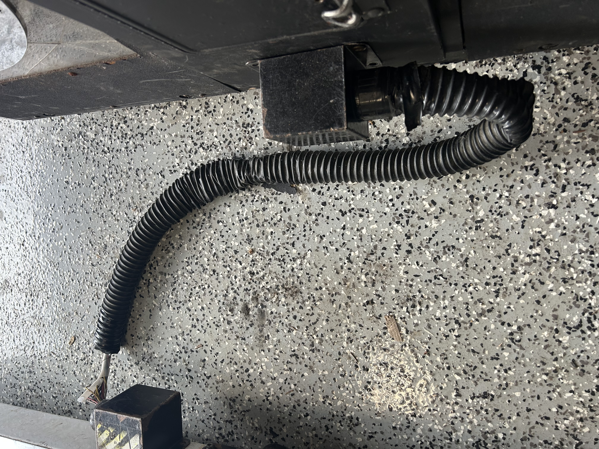
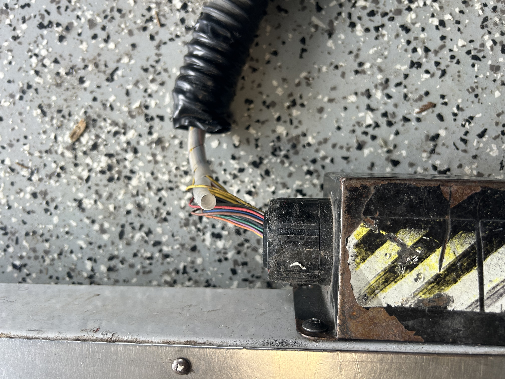
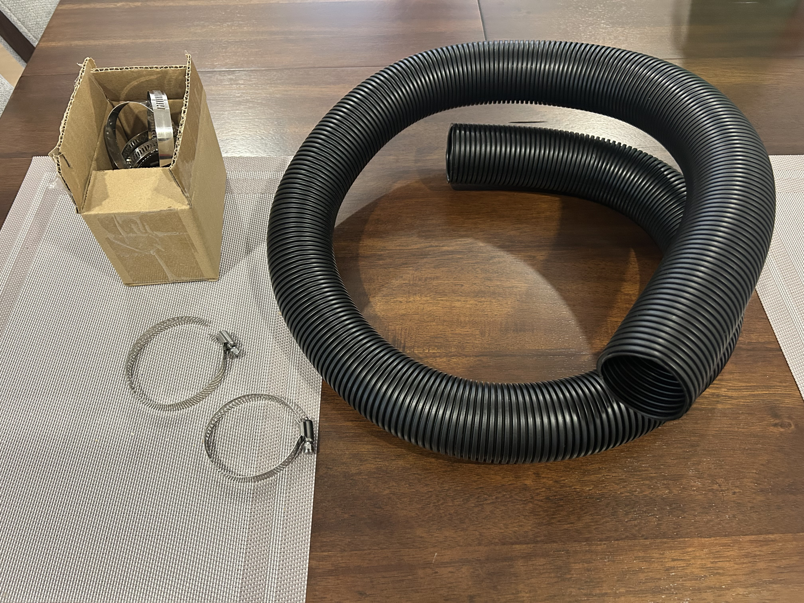
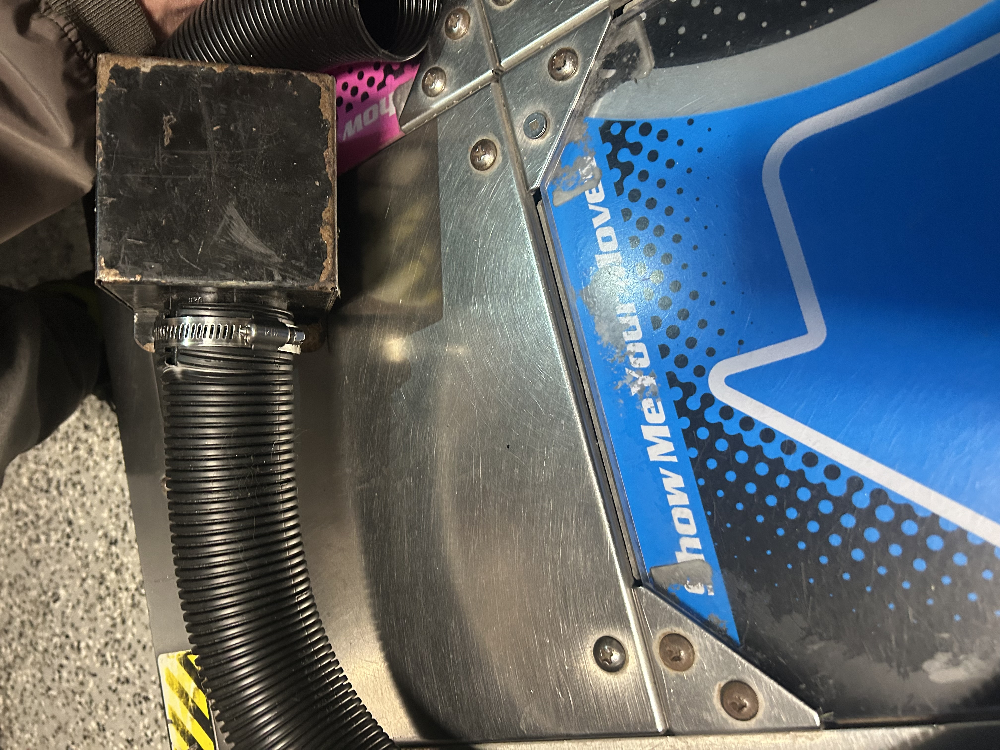
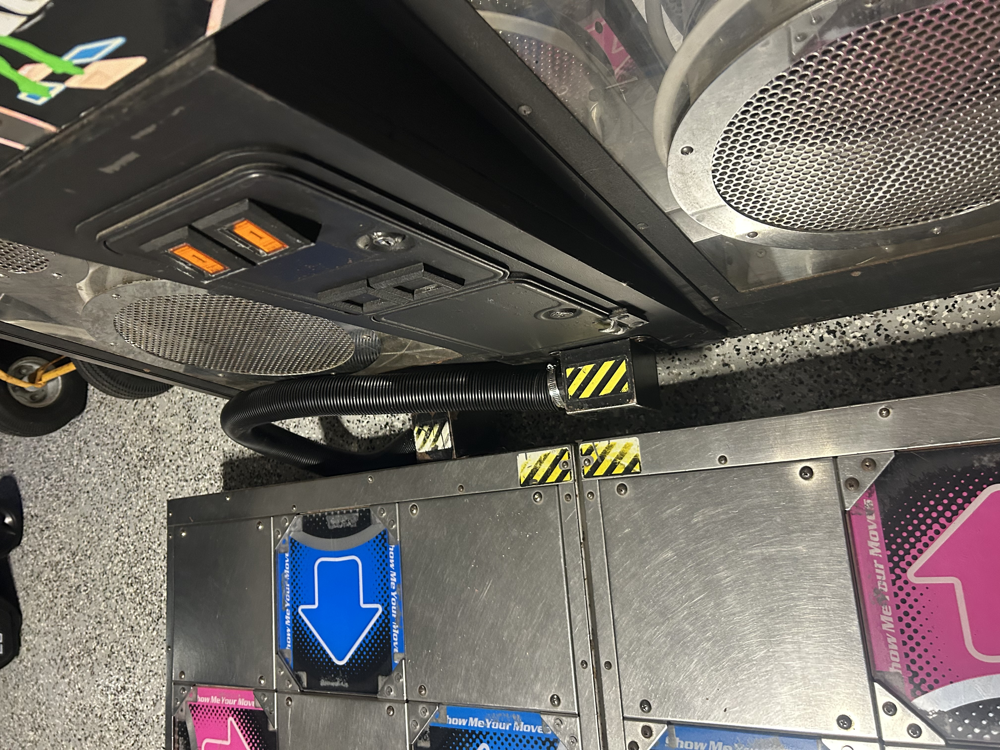

::: column-margin
## What I bought

- [Electriduct 2" Polypropylene Non-Slit Wire Loom Corrugated Flexible Conduit](https://www.amazon.ca/dp/B0CGFCQ16M)
- [Hose Clamp, 10 Pieces 2.5 Inch Stainless Steel](https://www.amazon.ca/dp/B09SW7ZQPZ)
:::

The wire conduit connecting the dance pad controllers to the cabinet was already pretty chewed up when the machine arrived. At the time, I figured it was mostly cosmetic and didn't pose much of a risk.

That was before winter.

 

With winter approaching, we'll be parking our car in the garage again. I didn't have the machine last winter, so this got me thinking about the exposed wiring. Snow, slush, and whatever else gets tracked in on the tires can quickly melt into a mess. The last thing I want is for moisture to find its way into the wiring and cause problems.

Time for a little preventative maintenance.

## Ordering parts

I noticed that ddrpad.com had both a replacement tube (complete with connector boxes) and a wire harness in stock. Unfortunately, the whole thing would have cost me around $300 CAD, before import fees. I was convinced this could be a DIY job.

I spent an unholy amount of time trying to figure out what to search for. "Black tube hose" wasn't getting me very far, but after plenty of trial and error, I eventually landed on a few useful terms:

- Dryer hose
- Tube sleeve protector
- Wire harness protector
- Wire conduit

*Conduit* turned out to be the right term for what I needed. I'm sure there are other names and alternatives that would work just as well, but this got me in the right direction.

A friend I spoke to over dinner also suggested hose clamps, which seemed like the simplest way to secure the new tubing to the connector boxes.

## Wiring it up

The installation itself wasn't particularly difficult, especially with a few tools and the help of my neighbor.

We started by unscrewing the connector boxes from both the dance pad and the cabinet. Next came the Molex connectors, which are a bit of a pain to remove. The trick here is to be careful not to snap anything or accidentally pull a wire loose.

Once everything was disconnected, we used a box cutter to carefully remove the old conduit. I took a little time to tidy up and re-bundle the wires before feeding them through the new tubing.

From there, we clamped both ends, reattached the connector boxes, and screwed everything back into place.

I won't go into a detailed step-by-step guide because, honestly, this is one of those jobs where the pictures pretty much tell the story.

Here is a look at the finished job

The new conduit gives the wiring a much better layer of protection against whatever winter throws at it. It also makes for a tighter, neater setup, leaving a little more room for my wife to park in the garage.

A relatively inexpensive fix, and one less thing to worry about.

Winter ready!

::::: series-nav
::: series-prev
[Previous: Vol 5: Stepmania Upgrades](../stepmania-upgrades/)
:::

::: series-next
:::

[All personal notes](../)
:::::
